# Ontología del dominio

## a. Propósito y alcance

Este documento describe **qué cosas existen** en wordle-stats, cómo se relacionan, dónde vive cada una, qué
estados atraviesan y qué reglas no pueden romperse nunca. Complementa al [glosario](glosario.md), que define
las palabras; aquí se dibuja la estructura.

Alcance: el dominio del juego (resultados, temporadas, clasificaciones, figuras, medallas, publicación), el
SuperWordleBros, el debate de reglas, los indicadores de juego y, al final, la ontología del propio método de
trabajo. Todo sale del código, las migraciones, los slices y los ADRs; cada afirmación cita su fuente
(`ruta:línea`). No incluye nombres de jugadores ni palabras del día: el repositorio es público.

Jerarquía de verdad: **specs + slices > ADRs / glosario > briefs > sources** (`docs/context/INDEX.md:11`).

## b. Conceptos y relaciones

### b.1 Núcleo: resultados, temporadas y clasificaciones

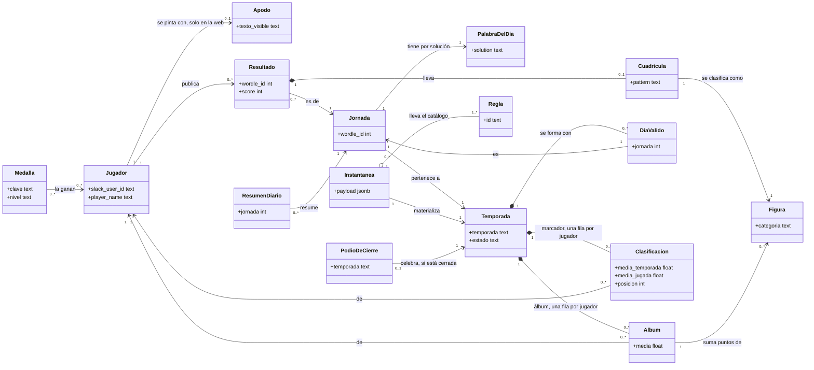

- **Jugador ↔ Resultado**: como mucho un resultado por (jugador, jornada), por el índice único
  (`openspec/decisions/0005-hosting-y-convivencia-v1-v2.md:102`, `tools/add_results.py:34`).
- **Jornada → Temporada**: `temporada_de(fecha)` da `AAAA-MM`, o `"0"` antes de `INICIO_TEMPORADAS`
  (`tools/seasons.py:51`); la fecha se deriva del número de jornada (`tools/add_results.py:60`).
- **DiaValido**: las jornadas laborables con al menos `MUESTRA_MINIMA_DEL_DIA = 5` resultados; en la
  temporada 0, todas (`tools/seasons.py:99`).
- **Cuadrícula 0..1**: sin patrón no hay figura y la partida no cuenta en el álbum (`tools/album.py:128`).
- **Figura** y **Medalla** no se almacenan: se derivan en cada cálculo (`tools/figures.py:9`,
  `tools/badges.py:8`); las medallas viajan como `logros: {clave: [jugadores]}` (`tools/seasons.py:225`).
- **Apodo** se indexa por nombre de Slack, no por id, y solo afecta a la pintura (`v2/js/domain/apodos.js:18`).
- **PodioDeCierre** es el mensaje que el código llama «victoria»: sale la noche del último laborable y, si
  faltara, lo publica el cron de los días 1 a 3 (`tools/post_ranking.py:688`, `tools/podio.py:129`,
  `.github/workflows/post_podium.yml:15`).

### b.2 El SuperWordleBros

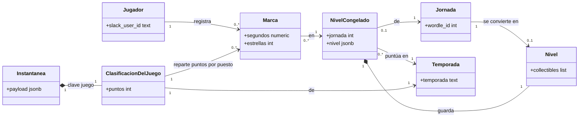

- **Nivel 0..1 por jornada**: solo si la jornada es día de temporada y alguien publicó cuadrícula
  (`v2/js/domain/superbros.js:112`, `v2/js/domain/superbros.js:173`).
- **Marca**: como mucho una por (jornada, jugador) (`supabase/migrations/20260925120000_create_game_times.sql:16`).
- **Puntúa en** la temporada de su fecha, salvo el nivel del último laborable del mes, que puntúa en la
  siguiente (`tools/juego.py:78`).

### b.3 Debate de reglas e indicadores de juego

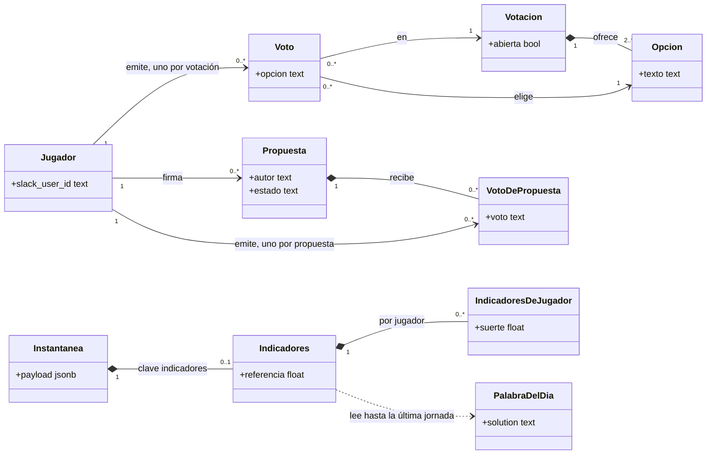

- **Votación con 2 o más opciones**: `check (jsonb_array_length(opciones) >= 2)`
  (`supabase/migrations/20261014120000_create_rule_debate.sql:21`).
- **Jugador** en el debate es cualquiera con al menos un resultado: las funciones rechazan a quien no ha jugado
  nunca (`supabase/migrations/20261014120000_create_rule_debate.sql:87`).
- **Indicadores 0..1**: solo si la lista de soluciones se pudo leer en el borde (`tools/seasons.py:239`); por
  jugador, cifras solo con `MINIMO_DE_PARTIDAS = 5` (`tools/indicadores.py:196`).

## c. Modelo de datos

Las tablas del juego y del debate tienen migración en `supabase/migrations/`. `wordle_results` y
`season_snapshots` **no**: su esquema está documentado en los ADRs 0005 y 0008 y lo confirman las columnas que
lee y escribe el código.

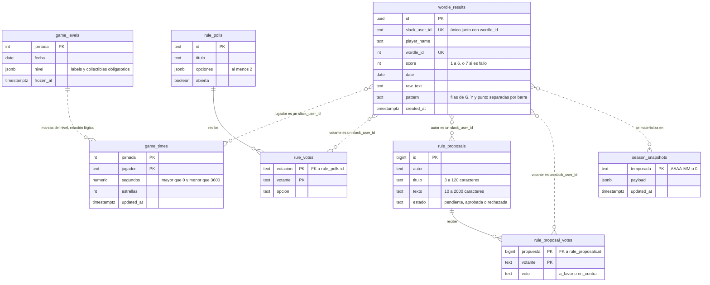

Solo hay dos claves foráneas reales (`rule_votes.votacion` y `rule_proposal_votes.propuesta`, con `on delete
cascade`); las relaciones punteadas son lógicas y las comprueban las funciones RPC, no el esquema. Fuentes de
cada tabla: las de la tabla siguiente.

### Concepto → dónde vive

| Concepto | Dónde vive | Fuente |
|---|---|---|
| Jugador | `wordle_results.slack_user_id` (no hay tabla de jugadores) | `tools/add_results.py:83` |
| Nombre mostrado | `wordle_results.player_name`; en cálculos, el de la fila más reciente | `tools/juego.py:65` |
| Apodo | constante de la web, aplicada al pintar | `v2/js/domain/apodos.js:18` |
| Forma gramatical | constante del pipeline, por nombre mostrado | `tools/personas.py:30` |
| Resultado / partida | fila de `wordle_results` | `tools/add_results.py:81`, `openspec/decisions/0005-hosting-y-convivencia-v1-v2.md:101` |
| Cuadrícula | `wordle_results.pattern` | `tools/patterns.py:6` |
| Jornada | `wordle_results.wordle_id` | `tools/palabra.py:5` |
| Palabra del día | lista de soluciones del juego, leída en el borde y nunca guardada | `tools/palabra.py:63` |
| Temporada | cálculo `temporada_de(date)` | `tools/seasons.py:51` |
| Instantánea | fila de `season_snapshots` (`temporada`, `payload`, `updated_at`) | `openspec/decisions/0008-donde-vive-el-calculo.md:75` |
| Estado de temporada | clave `estado` de la instantánea | `tools/seasons.py:211` |
| Día válido | clave `dias` (lista de jornadas) | `tools/seasons.py:212` |
| Dificultad del día | claves `dificultad`, `mas_dificil`, `mas_facil` | `tools/seasons.py:221` |
| Clasificación (marcador) | clave `clasificacion` | `tools/seasons.py:220` |
| Medallas | clave `logros`; nunca en una tabla | `tools/seasons.py:225` |
| Figura y álbum | clave `album`; la figura se deriva del patrón | `tools/seasons.py:228` |
| Figuras de la última jornada | `album.ultima_jornada` | `tools/album.py:157` |
| Clasificación del juego | clave `juego` | `tools/seasons.py:231` |
| Reglas | clave `reglas`, generada con `rules.catalogo()` | `tools/seasons.py:217` |
| Indicadores de juego | clave `indicadores` (opcional) | `tools/seasons.py:244` |
| Procedencia | clave `calculado_con` (commit) | `tools/seasons.py:234` |
| Nivel congelado | `game_levels.nivel` | `supabase/migrations/20260925140000_create_game_levels.sql:11` |
| Marca | fila de `game_times` | `supabase/migrations/20260925120000_create_game_times.sql:10` |
| Votación, opción | `rule_polls`, `rule_polls.opciones` | `supabase/migrations/20261014120000_create_rule_debate.sql:16` |
| Voto | `rule_votes` | `supabase/migrations/20261014120000_create_rule_debate.sql:26` |
| Propuesta | `rule_proposals` | `supabase/migrations/20261014120000_create_rule_debate.sql:35` |
| Voto de propuesta | `rule_proposal_votes` | `supabase/migrations/20261015090000_public_votable_proposals.sql:14` |
| Resumen diario, podio de cierre | mensajes de Slack; el título de la imagen es la marca de idempotencia | `tools/post_ranking.py:546`, `tools/post_ranking.py:173` |
| Señales y tono del hilo | memoria de la ejecución; no se persisten | `tools/senales.py:12` |

## d. Ciclos de vida

### Temporada

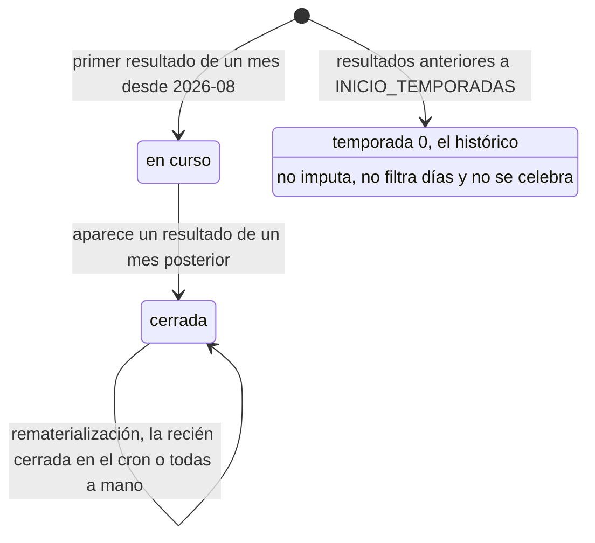

El estado se **deriva de los datos**: la temporada más reciente con resultados está en curso y las demás
cerradas (`tools/seasons.py:131`). Como el estado viaja en la instantánea, el cron rematerializa también
`RECIEN_CERRADAS = 1` temporada cerrada (`tools/materialize_seasons.py:228`). Una temporada sin días válidos
sigue existiendo, con cero días (`tools/seasons.py:137`).

### Nivel del SuperWordleBros

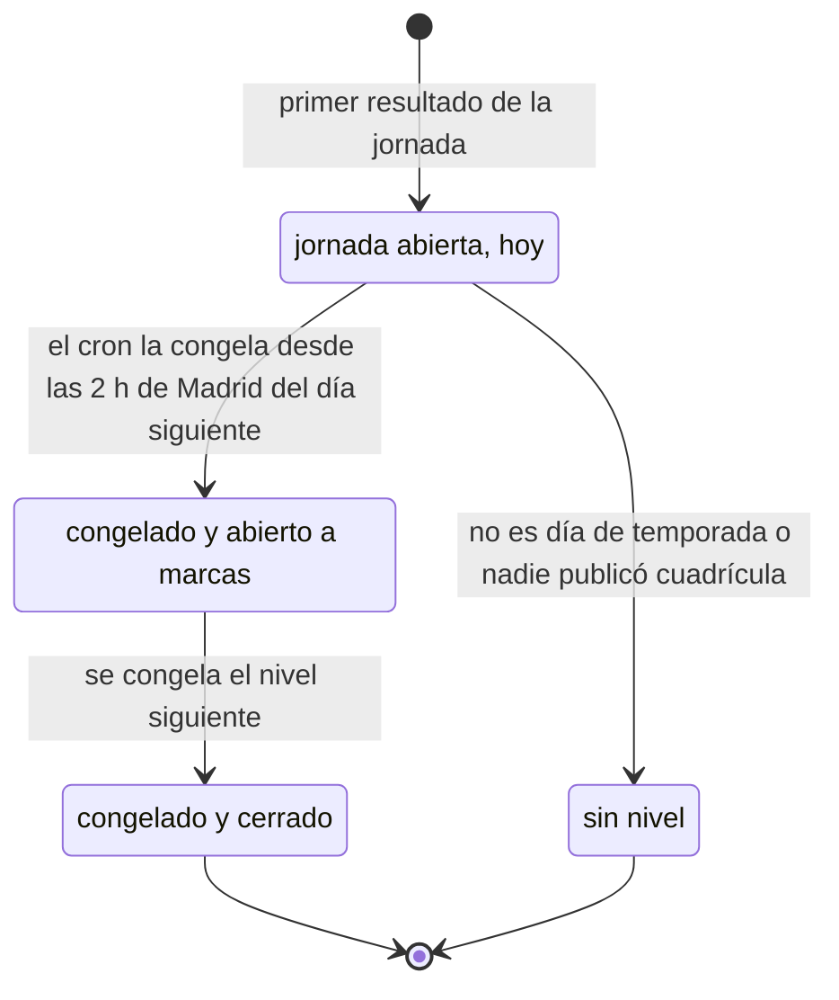

`HORA_DE_CONGELAR = "02:00"` (`v2/js/domain/superbros.js:67`, `tools/juego.py:30`); antes de esa hora se
congela la de anteayer, y la de hoy nunca (`v2/js/domain/superbros.js:105`). Un nivel congelado no se cambia ni
se borra (`supabase/migrations/20260925140000_create_game_levels.sql:41`). Solo el último congelado admite
marcas (`supabase/migrations/20260930120000_close_levels_and_rank_by_stars.sql:54`): el del viernes sigue
abierto el fin de semana, porque un fin de semana no crea nivel.

### Propuesta de regla

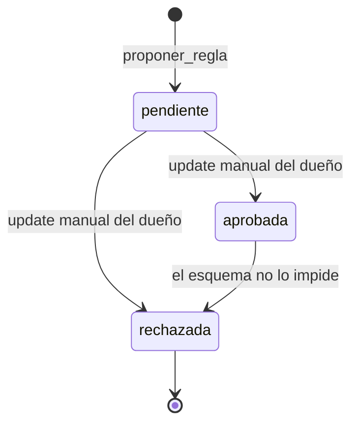

Nace `pendiente` (`supabase/migrations/20261014120000_create_rule_debate.sql:131`). **Pendientes y aprobadas
son públicas y se pueden votar**; solo `rechazada` se oculta a la clave pública y deja de admitir votos
(`supabase/migrations/20261015090000_public_votable_proposals.sql:11`,
`supabase/migrations/20261015090000_public_votable_proposals.sql:38`). Las transiciones son `update` manuales
del dueño desde Supabase (`supabase/migrations/20261014120000_create_rule_debate.sql:12`); el esquema solo
restringe los valores, no el orden.

### Votación

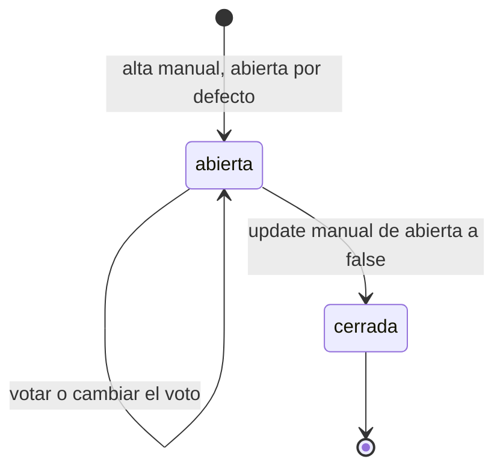

`abierta boolean not null default true` (`supabase/migrations/20261014120000_create_rule_debate.sql:22`);
`votar_regla` rechaza los votos de una votación cerrada (`supabase/migrations/20261014120000_create_rule_debate.sql:75`).

### Slice

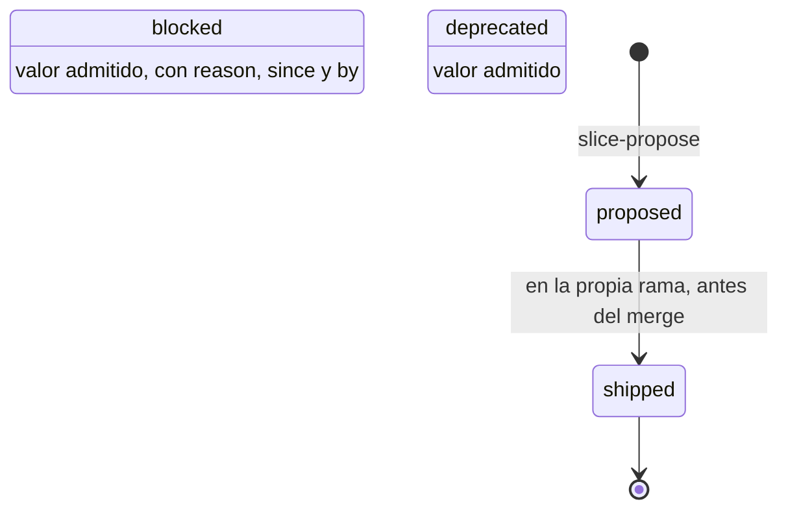

El estado es monotónico (`openspec/slice-system.md:34`). Con specs vivas, el slice pasa a `shipped` en la rama
antes de mergear, porque mergear despliega (`openspec/slice-system.md:226`). El protocolo no define las
transiciones hacia `blocked` y `deprecated`; por eso aparecen sin flechas.

## e. Invariantes del dominio

1. **Una X vale 7** y ninguna nota imputada lo supera (`FALLO = 7`): `tools/patterns.py:63`, `tools/standings.py:92`.
2. **La identidad es el id de Slack; el nombre es presentación**: ni un renombre ni un apodo cambian quién es
   alguien. `tools/add_results.py:5`, `v2/js/router.js:19`, `v2/js/domain/apodos.js:4`.
3. **Un resultado por jugador y jornada**; reingerir actualiza, no duplica. `tools/add_results.py:34`,
   `openspec/decisions/0005-hosting-y-convivencia-v1-v2.md:102`.
4. **La fecha sale del número de jornada**, nunca del reloj ni de la hora de publicación: `tools/add_results.py:60`.
5. **Una temporada es un mes natural**; lo anterior a `INICIO_TEMPORADAS = "2026-08"` es la temporada 0:
   `tools/seasons.py:39`, `tools/seasons.py:51`.
6. **Un día cuenta si es laborable y lo jugaron al menos `MUESTRA_MINIMA_DEL_DIA = 5` personas** (salvo en la
   temporada 0); la web repite la constante y un test exige que coincidan. `tools/seasons.py:30`,
   `tools/seasons.py:99`, `tools/calendario.py:42`, `v2/js/domain/superbros.js:79`.
7. **La temporada en curso se deriva de los datos**, no del reloj: `tools/seasons.py:131`.
8. **Faltar nunca mejora la media**: la imputación es al menos la media personal más un margen creciente; en el
   álbum, el denominador son las jornadas de la temporada. `tools/standings.py:90`, `tools/album.py:95`,
   `openspec/slices/ranking/clasificacion-de-temporada.md:64`.
9. **La misma cifra publicada comparte puesto** (1, 1, 3) y quien no clasifica aparece sin puesto:
   `tools/standings.py:185`, `openspec/slices/ranking/empates-comparten-puesto.md:41`.
10. **Figuras y medallas se derivan, no se guardan**: `tools/figures.py:9`, `tools/badges.py:8`.
11. **Un cambio de reglas de figuras no es retroactivo** (`PRIMERA_JORNADA_DEL_ORDEN_NUEVO = 1694`): `tools/figures.py:86`.
12. **El álbum y las medallas no alteran el marcador**; el álbum solo lo usa para desempatar:
    `tools/seasons.py:226`, `tools/rules.py:267`, `tools/album.py:211`.
13. **La web no recalcula**: pinta la instantánea que materializa Python, así que bot y web dicen lo mismo.
    `openspec/decisions/0008-donde-vive-el-calculo.md:61`, `tools/seasons.py:218`.
14. **Una instantánea por temporada, con su procedencia** (`calculado_con`): `tools/materialize_seasons.py:38`,
    `tools/seasons.py:234`.
15. **La lista de soluciones nunca se lee más allá de la última jornada jugada** y nada calculado lleva palabras:
    `tools/palabra.py:63`, `tools/indicadores.py:157`, `tools/seasons.py:243`.
16. **Un nivel congelado no cambia y solo el último congelado admite marcas**:
    `supabase/migrations/20260925140000_create_game_levels.sql:41`, `supabase/migrations/20260930120000_close_levels_and_rank_by_stars.sql:54`.
17. **Una marca solo se sobrescribe si mejora** (más estrellas, o las mismas en menos tiempo) y nunca baja del
    tiempo mínimo físico del nivel: `supabase/migrations/20260930120000_close_levels_and_rank_by_stars.sql:62`,
    `supabase/migrations/20260930120000_close_levels_and_rank_by_stars.sql:71`.
18. **Una persona, un voto**, por votación y por propuesta; votar otra vez lo cambia:
    `supabase/migrations/20261014120000_create_rule_debate.sql:32`, `supabase/migrations/20261015090000_public_votable_proposals.sql:20`.
19. **Solo vota, propone o registra marca quien ha jugado alguna vez**: `supabase/migrations/20261014120000_create_rule_debate.sql:87`,
    `supabase/migrations/20261014120000_create_rule_debate.sql:112`, `supabase/migrations/20260930120000_close_levels_and_rank_by_stars.sql:40`.
20. **Una votación cerrada no admite votos; una propuesta rechazada ni se ve ni se vota; como mucho tres
    pendientes por autor**: `supabase/migrations/20261014120000_create_rule_debate.sql:75`,
    `supabase/migrations/20261014120000_create_rule_debate.sql:105`,
    `supabase/migrations/20261015090000_public_votable_proposals.sql:38`.
21. **La clave pública no escribe en ninguna tabla**, solo lee y llama a funciones RPC:
    `openspec/decisions/0005-hosting-y-convivencia-v1-v2.md:105`, `supabase/migrations/20261014120000_create_rule_debate.sql:56`.
22. **Todo cambio de esquema es aditivo** mientras la v1 siga publicada:
    `openspec/decisions/0005-hosting-y-convivencia-v1-v2.md:90`.
23. **Del canal solo se persiste el resultado**; las señales son números y horas, sin texto: `tools/senales.py:8`.
24. **Sin reloj ni azar fuera del borde**: la fecha y los datos entran por parámetro. `openspec/slice-system.md:309`.

## f. Flujos

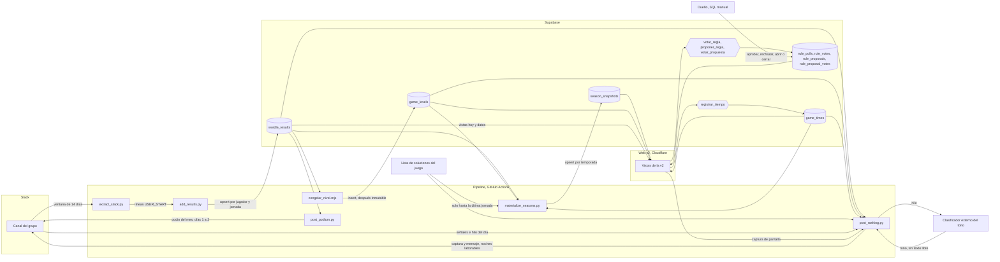

- **Sincronización** (`update_stats.yml`): un latido que encadena `extract_slack.py | add_results.py`,
  `materialize_seasons.py` y `congelar_nivel.mjs` (`.github/workflows/update_stats.yml:112`). Requisito:
  `MINIMO_DIARIO = 12` ejecuciones al día y huecos de como mucho `HUECO_MAXIMO_EN_HORAS = 2.0`
  (`tools/cadencia.py:18`, `tools/cadencia.py:21`).
- **Publicación diaria** (`post_ranking.yml`): tres ventanas de lunes a viernes por la noche; vuelve a ingerir
  antes de capturar y es idempotente por el título de la imagen (`.github/workflows/post_ranking.yml:22`,
  `tools/post_ranking.py:567`). El último laborable del mes publica la victoria en lugar del resumen
  (`tools/post_ranking.py:688`).
- **Cierre de mes** (`post_podium.yml`): días 1 a 3, solo si el mes no se celebró ya
  (`.github/workflows/post_podium.yml:15`, `tools/post_ranking.py:185`).
- **Escrituras de la web**, siempre por RPC (`v2/js/data/results.js:111`, `v2/js/data/results.js:189`); el bot
  no recalcula a su manera: usa los mismos módulos que la instantánea (`tools/resumen.py:8`).

## g. Ontología del método

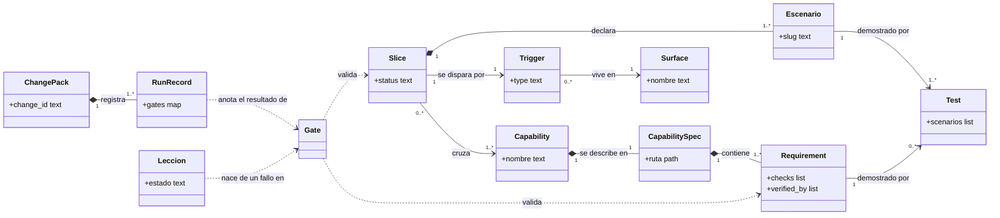

- Un slice **cruza** todas las capabilities que declara en `specs:[]`; multi-spec es la norma
  (`openspec/slice-system.md:21`). La capability spec es una **spec viva** que se edita en la misma rama que el
  código (`openspec/slice-system.md:121`); el change pack queda como registro mínimo con `runs.yaml`
  obligatorio (`openspec/slice-system.md:132`).
- Un Requirement necesita `checks:` o `verified-by:` (`openspec/slice-system.md:87`); cada escenario, al menos
  un test que lo declare con `@scenarios` (Gate 2, `openspec/slice-system.md:151`).
- Las lecciones se codifican en el punto más fuerte posible y se registran en `docs/lecciones.md`
  (`openspec/slice-system.md:334`).

Reglas de trigger y surface (`openspec/slice-system.md:61`, `openspec/README.md:40`):

| Trigger | Surface válida | Estado |
|---|---|---|
| `ui` | `web` | disponible; nunca sobre un módulo interno |
| `cron` | `pipeline` (GitHub Actions) | disponible |
| `command` | `pipeline` (script a mano) | disponible |
| `http` | ninguna todavía | reservado |
| `event` | ninguna todavía | reservado |
